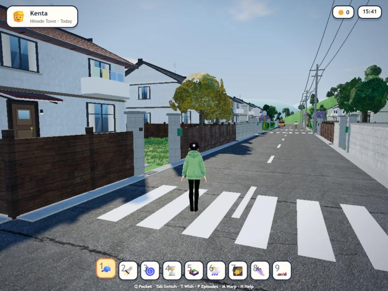

# Pocket Town

A free-roaming 3D sandbox game that runs in the browser, built with Three.js.

Kenta and his helper robot Tiko, who came from the year 2226, live in Hinode Town. You can be anyone in town, use 82 gadgets, travel to the age of dinosaurs or a future city, drive cars, play a full baseball match, and wish for anything. There is nothing to fail: go anywhere and do whatever you like.



## Play

```bash
npm install
npm run dev
```

Open http://127.0.0.1:5183 and press **Play**.

To build a static site:

```bash
npm run build
```

This writes to `dist/`. The repository deploys to Vercel as-is: `vercel.json` sets the Vite build and caches the large model and texture files.

## Controls

| Key | Action |
|---|---|
| W A S D | Move |
| Mouse / arrow keys | Look around (click the game to capture the mouse, or drag) |
| Shift | Run, or fly fast |
| Space / C | Jump or fly up / fly down |
| E | Talk, use things, get in or out of a car |
| F | Get in a car, hop off a ride |
| Q | Gadget pocket |
| 1–9 | Pick a hotbar slot |
| Click / R | Use the gadget in your hand (or click the slot again) |
| Right-click / G | The gadget's second mode |
| Tab | Become another character |
| M | Map: click to drop a marker, double-click to jump there |
| T | Wish box: type anything |
| P | Episodes |
| V | First / third person |
| H | Help |
| Esc | Menu, including graphics quality |
| F3 | Frame rate |

## What's in it

- **Hinode Town:** five walk-in homes, park, school, shop street with walk-in shops, a mansion with supercars, an empty lot, the levee, the river and bridge, a riverside ballpark and a lookout hill.
- **Two more eras:** Dino Valley, 100 million years ago (rideable dinosaurs), and Neo Hinode in 2226 (towers, sky lanes, hover cars).
- **82 gadgets**, among them a Propeller Cap, Elsewhere Door, Size Lantern, Time Pod, Critter Cracker and Hawk-Eye Drone.
- **Eight episodes**, playable in any order.
- **Baseball** with real rules and a line score.
- **Drivable cars**, a minimap and a full map.
- **Automatic quality trimming**, so it stays playable on integrated graphics.

All characters, places, gadget names and designs are original to this project.

## Project layout

`src/` holds the game modules:

- `main.js`: boot and game loop
- `town.js`, `eras.js`: the worlds
- `actors.js`, `cast.js`, `avatars.js`: characters
- `gadgets.js`, `vehicles.js`, `baseball.js`, `episodes.js`, `map.js`, `grass.js`

`PLAN.md` is the full design and handoff document.

## Credits

- [three.js](https://threejs.org) (MIT) and [@pixiv/three-vrm](https://github.com/pixiv/three-vrm) (MIT)
- **Character models** (`public/models/*.vrm`): VRoid Studio sample avatars, released under CC0 by pixiv. Taken from [madjin/vrm-samples](https://github.com/madjin/vrm-samples) (folder `vroid/beta`). Their textures were downscaled to 1024 px for faster loading.
- **Surface textures** (`public/textures/`): [Poly Haven](https://polyhaven.com), CC0. The scans used are asphalt_02, concrete_block_wall, red_brick, painted_plaster_wall, grey_roof_tiles_02, weathered_brown_planks, weathered_plank_siding, concrete_pavement, wood_floor, bark_brown_02, rock_05 and dirt_floor.
- Everything else (buildings, trees, grass, sky, robots, animals, dinosaurs, cars, sounds) is generated in code.
